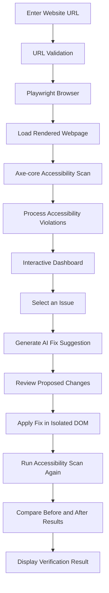

# ♿ Accessibility Copilot

### Your AI-Powered Assistant for Building More Accessible Websites

**Accessibility Copilot** is an AI-powered website accessibility auditing and remediation tool designed to help developers identify, understand, and address accessibility issues in their websites.

It combines automated accessibility testing, visual issue identification, AI-assisted code suggestions, and verification through an isolated DOM simulation to make accessibility testing more actionable.

Built as part of **CoNSTruct 2.0 | Replit × Newton School of Technology Product × AI Hackathon**.

---

## 🚀 Live Demo

**Try Accessibility Copilot:**  
https://primordial-princechhikara.replit.app/

**GitHub Repository:**  
https://github.com/whyvedant0707/Primordial

---

## 🎯 The Problem

Many websites contain accessibility issues that make them difficult to use for people with disabilities.

Common examples include:

- Images without meaningful alternative text.
- Poor color contrast between text and backgrounds.
- Form fields without proper labels.
- Buttons and links without accessible names.
- Incorrect or missing ARIA attributes.
- Problems with semantic HTML structure.

Although automated accessibility tools can detect many of these issues, developers often struggle to understand the violations and determine how to fix them.

Accessibility Copilot aims to bridge this gap by turning accessibility reports into understandable, actionable remediation suggestions.

---

## 💡 Our Solution

Accessibility Copilot provides developers with a workflow to:

1. Scan a website for accessibility issues.
2. Understand detected violations through clear explanations.
3. Locate problematic elements visually.
4. Generate contextual AI-powered fix suggestions.
5. Simulate proposed fixes and verify their impact.
6. Review accessibility aspects that require human evaluation.

The goal is not just to detect accessibility problems, but to help developers understand and address them.

---

## ✨ Key Features

### 1. Automated Website Scanning
- Enter a public website URL to initiate an accessibility scan.
- Uses Playwright to load and inspect rendered webpages.
- Uses Axe-core to detect accessibility violations.
- Evaluates selected WCAG 2.0 and WCAG 2.1 Level A and AA rules.

### 2. Interactive Accessibility Dashboard
- Displays an overview of detected accessibility issues.
- Organizes violations by severity.
- Provides details about affected elements.
- Highlights problematic elements using visual bounding boxes.
- Helps developers understand where each issue occurs.

### 3. AI-Powered Fix Suggestions
- Generates contextual remediation suggestions for detected issues.
- Provides proposed code changes.
- Explains why a change is needed.
- Helps developers understand possible ways to improve accessibility.

### 4. Apply & Verify
- Simulates proposed changes in an isolated DOM snapshot.
- Runs accessibility checks again after applying a proposed change.
- Compares measured results before and after the change.
- Checks for unresolved violations and potential regressions.
- Avoids claiming successful verification when the required baseline evidence is unavailable.

**Note:** Changes are simulated in an isolated environment. The original live website and its source code are not modified.

### 5. Human Review Checklist
Automated tools cannot reliably evaluate every accessibility requirement.

The Human Review Checklist helps developers manually review aspects such as:
- Meaningful image descriptions.
- Keyboard navigation.
- Focus visibility.
- Content readability.
- Appropriate use of interactive components.
- Other accessibility considerations requiring human judgment.

---

## 🛠️ Technology Stack

| Category | Technologies |
|---|---|
| Frontend | Next.js, React |
| Backend | Node.js, Express.js |
| Browser Automation | Playwright |
| Accessibility Testing | Axe-core |
| Validation | Zod |
| AI Integration | OpenAI-compatible AI provider |
| Database | MongoDB (optional integration) |
| Deployment | Replit |

---

## ⚙️ How It Works

The application follows a multi-stage accessibility auditing workflow.

### Workflow Explanation

1. **URL Submission:** The developer enters the website URL.
2. **Validation:** The backend validates the submitted URL and applies security checks.
3. **Browser Execution:** Playwright opens the website in a headless Chromium browser.
4. **Accessibility Audit:** Axe-core analyzes the rendered webpage.
5. **Issue Identification:** Detected violations are processed and displayed in the dashboard.
6. **AI Remediation:** The developer selects an issue and requests a contextual fix suggestion.
7. **Simulation:** The proposed change is applied to an isolated DOM snapshot.
8. **Verification:** Axe-core runs again to check whether the original violation has been resolved and whether regressions were introduced.

---

## 🏗️ Architecture

Accessibility Copilot separates the frontend, backend, scanning engine, and remediation workflow.

| Component | Responsibility |
|---|---|
| Frontend | User interface, scan submission, dashboard, and issue inspection |
| Backend API | Request handling, validation, scan orchestration, and remediation |
| Playwright | Headless browser execution and rendered webpage inspection |
| Axe-core | Automated accessibility rule evaluation |
| AI Service | Contextual remediation suggestions |
| Verification Engine | Isolated DOM patch simulation and accessibility re-scanning |

---

## 📚 Accessibility Standards

Accessibility Copilot uses selected automated rules associated with:

- **WCAG 2.0 Level A and AA**
- **WCAG 2.1 Level A and AA**

Useful references:

- [W3C Web Content Accessibility Guidelines (WCAG) 2.1](https://www.w3.org/TR/WCAG21/)
- [WAI-ARIA 1.2 Specification](https://www.w3.org/TR/wai-aria-1.2/)
- [WAI-ARIA Authoring Practices Guide](https://www.w3.org/WAI/ARIA/apg/)
- [Axe-core Documentation](https://github.com/dequelabs/axe-core)

---

## ⚠️ Limitations

Accessibility is broader than what automated testing can measure.

- Automated scans cannot identify every WCAG violation.
- Some accessibility requirements need manual testing and human judgment.
- Third-party websites may block automated browser requests.
- Cross-origin iframes, canvas content, and certain dynamic components may have inspection limitations.
- AI-generated suggestions should be reviewed before being used in actual source code.
- Apply & Verify operates on an isolated DOM simulation and does not directly modify the original website.

**Accessibility Copilot does not certify that a website is fully WCAG compliant.** It helps developers identify issues and improve accessibility through automated testing, AI assistance, and human review.

---

## 👥 Team Primordial

Built with collaboration, experimentation, and a shared goal of making the web more accessible.

- **Sanprit Danav**
- **Vedant Asutkar**
- **Manisha Jain**
- **Prince Chhikara**

---

## 🙌 Acknowledgements

A special thanks to:

- [Replit](https://www.linkedin.com/company/repl-it/)
- [Syed Adil](https://www.linkedin.com/in/adil-curio-revelio/)
- [Newton School of Technology](https://www.linkedin.com/school/newton-school-of-technology/)
- [The Product Folks](https://www.linkedin.com/company/theproductfolks/)

For providing the opportunity and platform through **CoNSTruct 2.0 | Replit × Newton School of Technology Product × AI Hackathon**.

---

